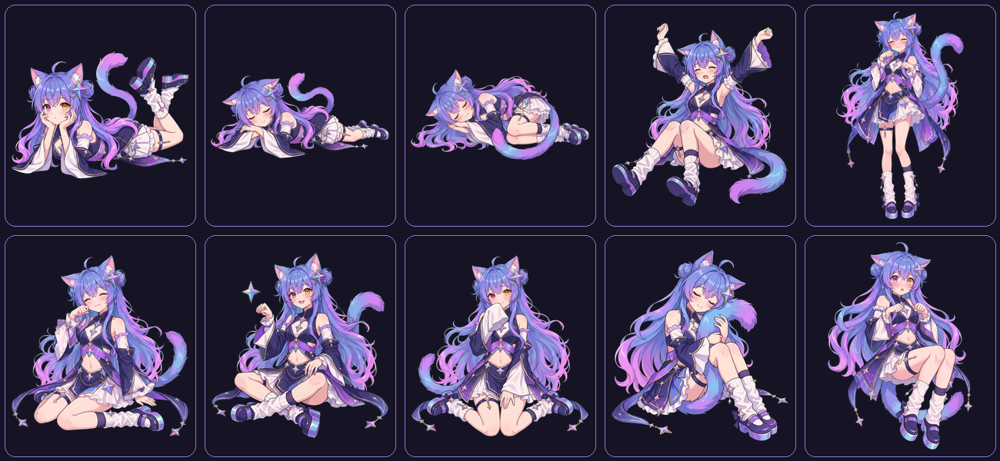

<div align="center">

# Gemini Catgirl 2D Desktop Pet (Gemini 猫猫桌宠)

基于 **Python + PySide6 + OpenCV** 打造的 Windows 透明 2D 桌面宠物。  
不用 Live2D 模型文件，通过实时 2D 网格变形实现 **60FPS 自然眨眼、晃脚、摇尾、眼神跟随与连续撸猫**，并自带 Gemini 标志性的「极其」口癖与进程感知吐槽！


</div>

## 10 套猫猫姿势一览



## 核心特性

- **60FPS 实时活体微动画**（[pet/live_deformer.py](pet/live_deformer.py)）
  - 默认趴桌姿势支持 **3 阶段自然眨眼**（睁眼 → 半闭 → 闭眼，随机双眨眼）、**猫尾 S 形波浪摆动**、**双脚悠闲晃动**、**左右猫耳独立抖动**、**呆毛与发丝微风摆动**。
  - **鼠标眼神微跟随**：光标靠近时，头部轻微转向且异色瞳虹膜微微看向鼠标。
  - **说话口型同步**：对话气泡弹出时自动同步嘴部开合动画。
- **自然互动体验**
  - **连续撸猫抚摸**：鼠标在猫耳/头顶来回轻抚，原地融化为眯眼小虎牙开心表情、加快摇尾并飘出爱心与星芒。
  - **10 套独立猫猫姿势**：趴桌晃脚、趴桌瞌睡、侧躺安睡、摸头呼噜噜、猫猫爪爪洗脸、盘腿玩星芒、害羞鸭子坐、抱尾打盹、伸懒腰打哈欠、拎猫悬空，切换采用 0.26s 缓动交叉淡入过渡。
  - **拖拽钟摆物理 & 滚轮无级缩放**：自由拖动（带衣领支点摆动物理）、滚轮缩放并支持 Windows HiDPI 高清渲染。
- **贴心作息提醒与系统感知**
  - **进程与系统感知**：原生 Win32 API 轻量识别当前活跃应用（写代码 / 打游戏 / 听音乐 / 办公 / 看视频 / 创作 / 聊天）与低电量状态，带防抖与冷却，自动弹出对应 Gemini「极其」风格吐槽气泡。
  - **全屏自动隐藏**：看视频、玩游戏或演示 PPT 进入全屏时自动隐藏并暂停动画渲染（零 CPU 占用），退出全屏后静默恢复。
  - **作息与学习提醒**：支持自定义午餐、晚餐、睡觉定时提醒，以及学习/专注间隔休息提醒，附带系统托盘通知与可视化设置面板。

## 快速开始

### 方式一：普通用户直接下载（Windows 免安装）
1. 前往本仓库右侧 [**Releases**](https://github.com/Harlan1997/gemini-cat-pet/releases) 页面下载 `GeminiCatPet-win64.zip`。
2. 解压到任意文件夹，双击里面的 **`GeminiCatPet.exe`** 即可运行（无需安装 Python）。

### 方式二：源码运行（开发者）
- 环境要求：Windows 10 / 11，Python 3.10+
```powershell
python -m venv .venv
.\.venv\Scripts\python.exe -m pip install -r requirements.txt
.\.venv\Scripts\python.exe main.py
```
或者直接双击项目根目录的 `start_pet.bat` 无黑框启动。

## 项目结构
```text
├── main.py                  # 启动入口与系统托盘
├── start_pet.bat            # Windows 无黑框一键启动脚本
├── requirements.txt         # 依赖列表
├── assets/                  # 高清透明立绘与面部微动画层
├── docs/                    # README 预览动图与姿势展示图
├── pet/
│   ├── pet_window.py        # 主透明窗口、交互状态机与渲染循环
│   ├── live_deformer.py     # 基于 OpenCV remap 的 2D 网格微变形引擎
│   ├── activity_watcher.py  # 原生 Win32 前台应用/后台音乐/低电量感知
│   ├── fullscreen.py        # 原生 Win32 全屏检测与自动隐藏
│   ├── bubble.py            # 悬浮磨砂对话气泡
│   ├── particles.py         # 四角星 / 爱心 / Zzz 粒子特效
│   ├── reminder.py          # 吃饭/睡觉/学习提醒与设置弹窗
│   ├── dialogue.py          # Gemini「极其」口癖台词与提醒文案
│   └── config.py            # 本地配置读写
└── tools/                   # 绿幕抠图、面部对齐与打包发布脚本
```

## 致谢与声明
- 角色形象灵感参考自 B 站 UP 主 **`ZipZipPipe`** 的视频作品《大AI和小AI们》（AI 合成形象），本项目内全部桌面宠物立绘与面部微动画均已重新绘制并精抠制作。
- 本项目完全开源免费，仅限个人桌面美化与技术交流使用，请勿用于任何商业用途。
